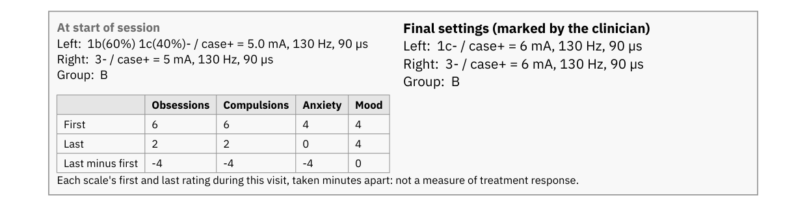
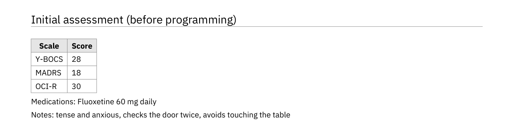
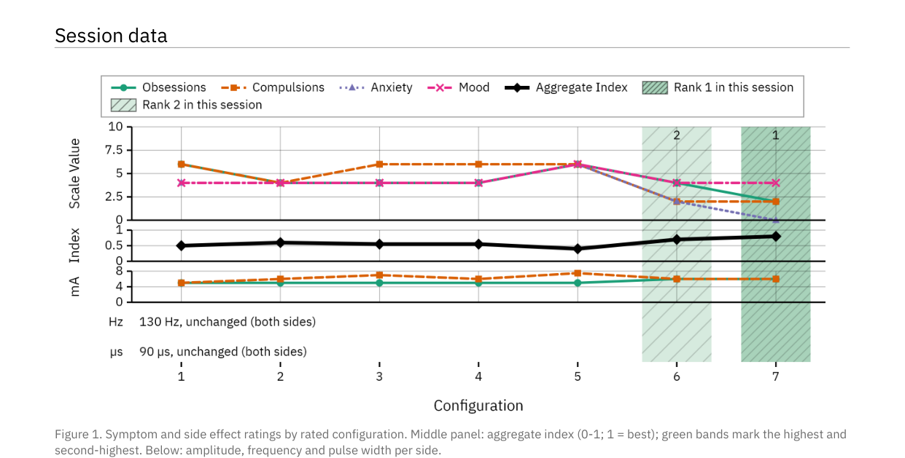
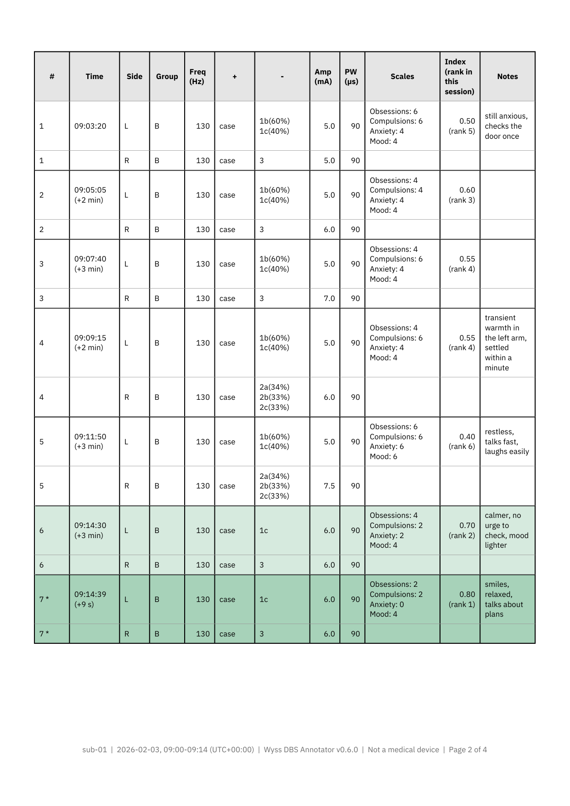
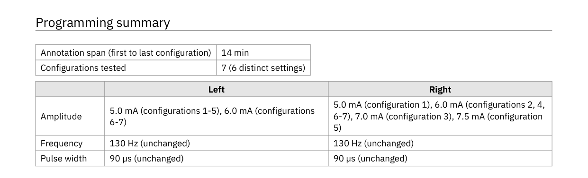
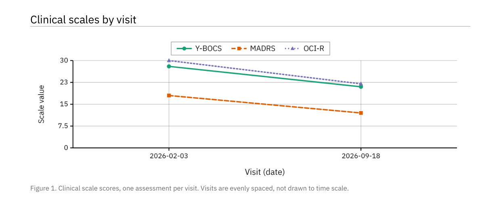
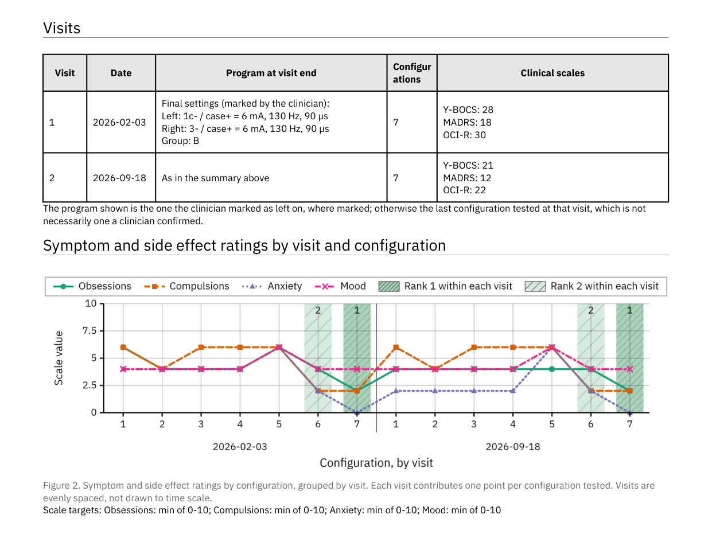
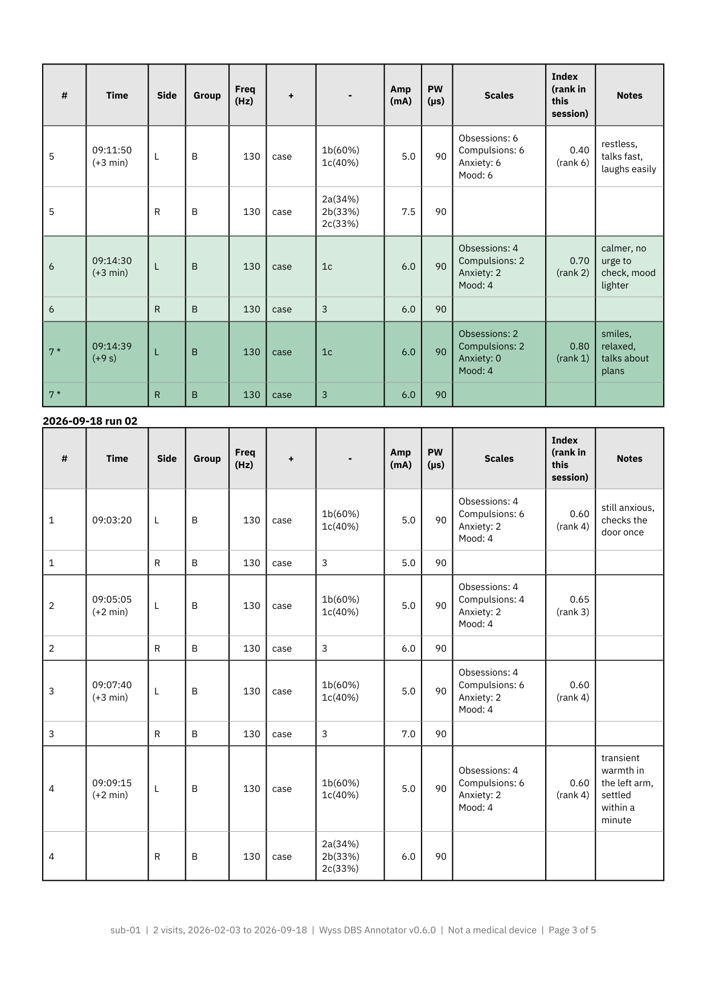

Reports
========

Every workflow can produce a report in **PDF** and in **Word** (``.docx``). Both
are built from the same computed values, so the two documents cannot disagree
with each other, a property worth having when one is filed and the other is
edited.

Every image on this page is the real report, generated from the synthetic
example session shipped with the app.

A session report is exported from the Finish step, or from **Export this session** on the
Session step. Reports across visits are made from **Other sessions** on the Session step;
see :doc:`screens/import_export`.

Choosing what goes in
---------------------

Exporting asks which sections to include, and lets you set the
:ref:`scale targets <scale-targets>` at the same time. Paper size (A4 or Letter)
applies to both formats.

The patient header is always present, so a report is never anonymous.

Session report
--------------

Header and page-one box
~~~~~~~~~~~~~~~~~~~~~~~

The header gives the patient ID, the session date and clock span *taken from the
saved rows* with their UTC offset, and separately the date the document was
generated, the app version, and the source filename with its row count. The
session date and the generation date are distinct fields on purpose: a report
produced a fortnight later must not assert that the session happened the day the
button was pressed.

Under it, a box with the first and the last settings per side in
:doc:`contact notation <glossary>`:
contacts with their share of current, total milliamps, frequency, pulse width and
group. Then what changed between the two, and the response of each symptom and side
effect rating from the first to the last rated configuration, so the outcome of the
visit sits next to what was tried. The last settings are named for what they are: the
final settings when a clinician confirmed them, otherwise the last configuration in the
file, which nothing in the data shows a clinician *confirmed*.

Initial assessment
~~~~~~~~~~~~~~~~~~

The clinical scale scores entered before stimulation changes began, as a compact
two-column table, with the medications and the notes of the initial assessment under it.

Session data
~~~~~~~~~~~~

*The figure* has one configuration axis shared by stacked panels: the symptom and side effect
ratings, the aggregate index (a 0-1 score per configuration against your
:ref:`scale targets <scale-targets>`), then the amplitude, frequency and pulse width
per side, as in the live view in the app. A parameter that never changed during
the session is stated in one line, such as "130 Hz, unchanged (both sides)",
rather than plotted flat. When targets are set, green bands mark the best and
second-best scoring settings through every panel.

*The table* gives one row per side per configuration: time, group, frequency, anode,
cathode with the per-contact current share, total amplitude, pulse width, the
scale ratings, the aggregate index with its rank, and notes. Values belonging to
the configuration are printed once, not repeated per side, and the line between its two
sides is light while the rule between configurations is heavy, so each one reads as a
unit. With no targets set, nothing is ranked and the Index column is left out rather
than printed empty.

A notes file imported with the session makes a longitudinal report rather than
this one; see :ref:`notes in the longitudinal report <longitudinal-visits>`.

Under the table, the legend: what the green means, the targets, how many ratings
were taken per configuration when that differs between configurations, how far
repeat ratings of one setting differ, how the index
is computed, and the disclaimer. It is kept on one page, so the disclaimer is
never separated from the shading it qualifies.

Electrode configuration
~~~~~~~~~~~~~~~~~~~~~~~

The initial settings and the last configuration as two pairs of lead diagrams, Left and
Right of each close together, each captioned with its configuration in words,
plus a key for the anode and cathode colours. The caption matters: the drawing shows
*which* contacts are active but not how current is shared, and for current
steering the split is the configuration.

.. figure:: _static/reports/session_report_electrodes.png
   :alt: Two pairs of lead diagrams: initial and last settings for each side
   :width: 100%

Programming summary
~~~~~~~~~~~~~~~~~~~

Two short tables: the annotation span and the number of configurations tested,
then the amplitude, frequency and pulse width actually tried, one side per column.
Then the response: one column per rating, its first and last rated value and the
change between them. That is the clinical bottom line, and it cannot be recovered
from the parameter ranges alone, which is why the same table also sits in the
page-one box.

Attestation
~~~~~~~~~~~

**Documented by** and **Rated by**, over rules to sign on. Both names are asked,
optionally, when the report is exported: who annotated the session and who rated it.
They are printed on the report and saved nowhere else; a name left empty leaves the
rule blank for a signature.

Longitudinal report
-------------------

Two or more imported files of one patient, compared across visits; a notes
file counts as one of them. See
:doc:`screens/import_export` for the screen that produces it. However the files were
picked, visits are ordered by patient and then from the earliest to the most
recent, here, in the combined table and in the BIDS export.

If the imported files name more than one patient, the report says so in a box on
page one. Combining two people into one longitudinal report is a safety problem,
not a formatting one.

Page one also carries a summary of the latest visit: its date and the final settings, when the
clinician confirmed them, or else the last configuration saved, one line per side with its
contacts. Both figures fit on page one under it, on A4 and on US Letter.

Clinical scales by visit
~~~~~~~~~~~~~~~~~~~~~~~~

One assessment per visit, so the x axis is the visit itself, labelled by its
date (with the run added only when two visits share a day). This is the "is the
patient better than last time" figure. Its axis starts at zero, since a clinical
total is a magnitude, and reaches at least the top of each plotted scale's range
when the :ref:`clinical scales settings <dialog-clinical-scales>` give one, so a
score reads against its scale. The ranges set the axis only and are never
printed. Visits are evenly spaced, not drawn to time scale.

.. _longitudinal-visits:

Visits
~~~~~~

The date, the program in force at the end of that visit with Left and Right on
separate lines and their contacts, headed "Left on" when the clinician marked
it, the number of configurations tested, and every clinical scale entered at that
visit, one per line. How each scale moved between visits is what the figure
above shows. A day with imported notes but no session gets its own numbered row,
in date order among the visits, with only its date filled; its notes appear
under that date in the session data below. Notes from a visit day appear in that
visit's session table. Imported with no session at all, the notes
are the whole report: it says that no session file was imported and lists every
note by date.

Symptom and side effect ratings by visit and configuration
~~~~~~~~~~~~~~~~~~~~~~~~~~~~~~~~~~~~~~~~~~~~~~~~~~~~~~~~~~

Several configurations per visit, so each visit contributes a run of points.
The ticks are the configuration numbers, with each visit's date centred under its own
configurations and a rule between visits. With scale targets set, green bands mark the
two best configurations across all visits together, the targets they were
ranked by are printed under the figure, and the axis is fixed to the declared
range. Every visit's
index is computed against the same targets and declared ranges, which is what
makes one ranking across visits meaningful.

.. figure:: _static/reports/longitudinal_report_session_scales.png
   :alt: Ratings for every configuration of every visit, the two best across all visits banded
   :width: 100%

Session data per visit
~~~~~~~~~~~~~~~~~~~~~~

Each visit's table, under its own heading, laid out as in the session report. With
targets set, the same two configurations as in the figure are shaded green:
the highest and second-highest aggregate index across all visits. The Index
column says so in its header, **Index (rank across all visits)**, because the
same configuration carries its rank within the visit in that visit's own session
report, headed **Index (rank in this session)**.

Programming summary and source files
~~~~~~~~~~~~~~~~~~~~~~~~~~~~~~~~~~~~

For each visit, the same tables as the session report's programming summary:
how many configurations were tested, and the amplitude, frequency and pulse
width used on each side. *Source files* lists the imported files the report was
built from: the session files with their configuration counts, then the notes files.

.. _scale-targets:

Scale targets
-------------

Ranking configurations requires knowing what "better" means for each symptom and side effect
rating, and
only you know that. Each scale gets a mode:

``Min``
   Lower is better, as for a symptom severity score.

``Max``
   Higher is better, as for a function or quality-of-life score.

``Custom``
   Closest to a stated value is better.

``Ignore``
   Not scored: counted as neutral, see below.

The aggregate index of a configuration is a weighted mean over the ratings taken at that
configuration. Each scale with a target is normalised into its declared range, oriented
by its target and clipped to 0-1, where 1 is best, and counts at full weight. A
scale set to ``Ignore`` counts as a neutral 0.5 at half weight, so it neither
helps nor harms a configuration. One scale with a target is enough to rank; with none,
nothing is ranked. The report prints this definition and the bounds each scale
was normalised into, so the number can be reproduced.

.. _what-the-reports-do-not-say:

What the reports do not say
---------------------------

The ranking is a computation over the saved ratings, and its limits are
worth stating here as plainly as the reports themselves state them.

**It does not account for side effects or tolerability.** A configuration that
scored well on every scale and produced an intolerable paraesthesia will be
ranked highly. The notes column is not an input.

**It is not a recommendation.** It does not say which settings to program.

**The session report will not rank without targets.** With no scale targets
set, no configuration is ranked, nothing is shaded green, and the report says
so. Defaulting every scale to "lower is better" would silently score *falling
mood* and *falling energy* as improvements, and inventing a clinical intention
is worse than declining to rank.

**The longitudinal report ranks against defaults when none are set.** Made from
**Other sessions** with no targets confirmed, it ranks against the targets the
targets dialog proposes, every scale minimised over 0 to 10, and prints them
under the ratings figure and the session tables. Those printed targets
are the only trace of what the ranking assumed; where a scale should rise, set
its target before exporting.

**"Last configuration tested" is not "chosen".** It is the last configuration in the
file, and a setting that was tried and rejected would appear there identically.
Only a configuration the clinician confirmed as the final settings is called
so, headed **Final settings (marked by the clinician)**.

**The numbers carry no instrument metadata.** The file stores no scale anchors,
administration method or rater, so those cannot be reproduced from a report. A
rater named at export is printed on that report only.

Where the session's own data allows it, the report also prints the spread between
repeat ratings of an unchanged setting, which measures how far the index moves
when nothing changes, so that two settings closer together than that can be seen
for what they are.

Fonts
-----

The PDF reports are set in IBM Plex Sans, regular and bold, bundled with the
app under the SIL Open Font License (``assets/fonts/LICENSE-IBMPlexSans.txt``).
The reports use no italic, so every character is drawn from those two faces.
Without them the exporter falls back to Helvetica, which covers Latin-1 only:
a curly quote or an accented character in a clinical note would print as
``?``, and the app warns when that happens. The same files make the
documentation screenshots reproducible, since the test environment that draws
them ships no fonts of its own.

To replace them, use the static TTFs from
`Google Fonts <https://fonts.google.com/specimen/IBM+Plex+Sans>`_ or the
`IBM Plex releases <https://github.com/IBM/plex/releases>`_.
