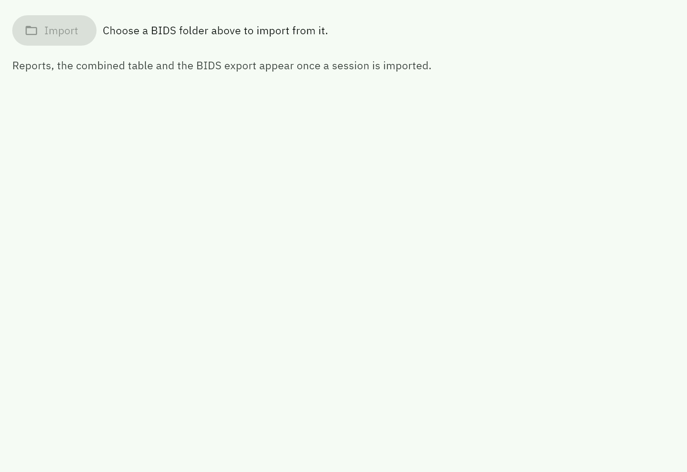
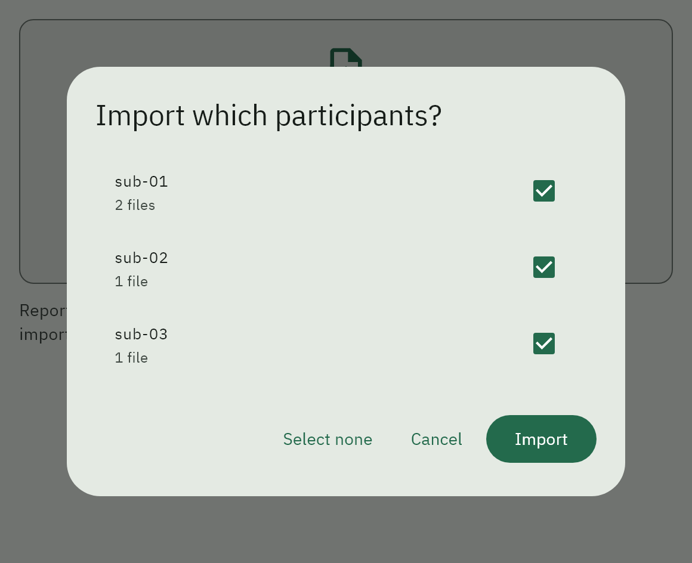
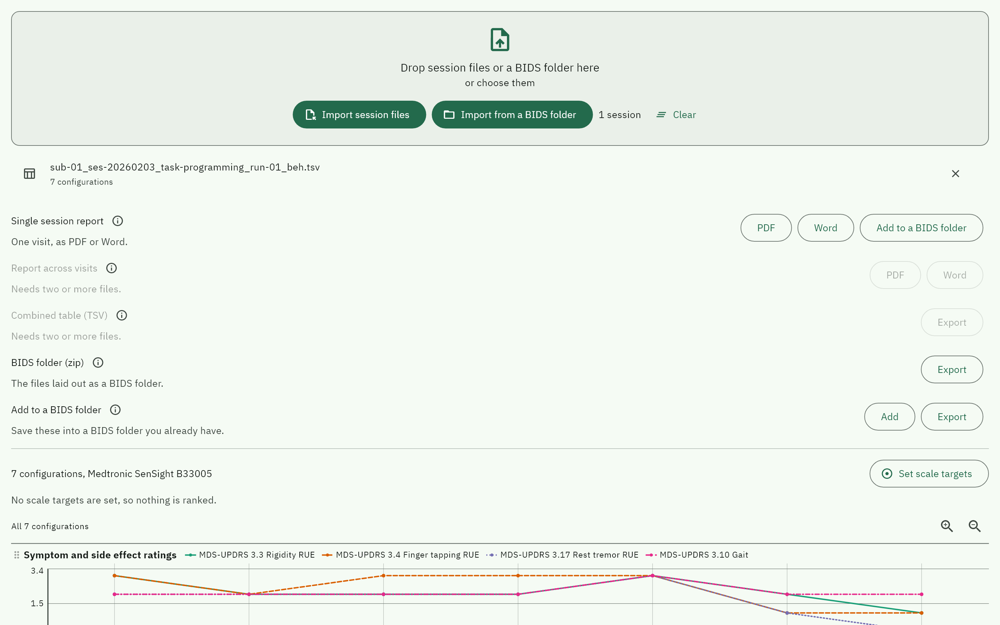
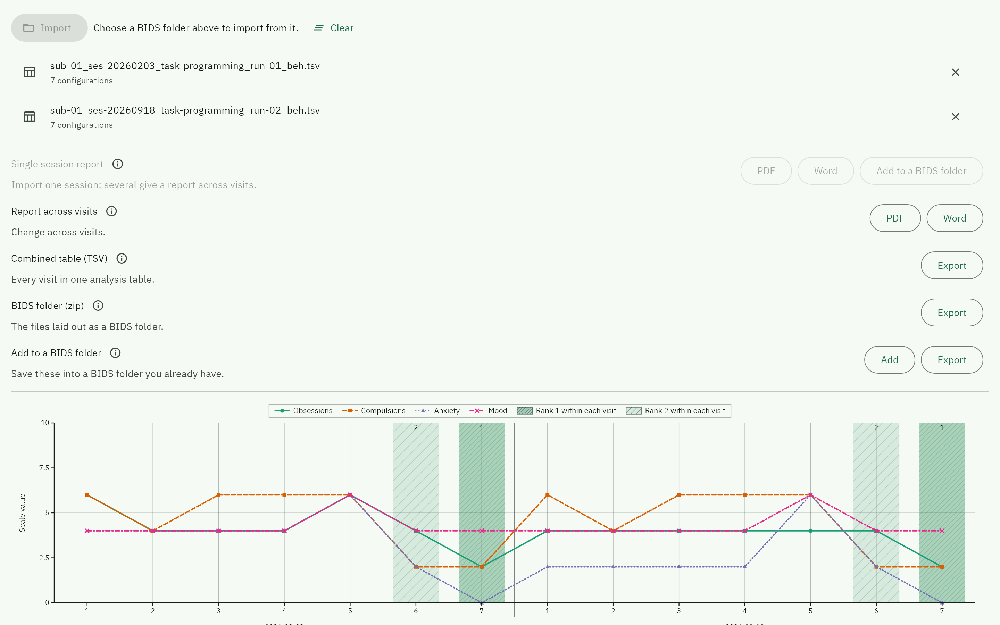
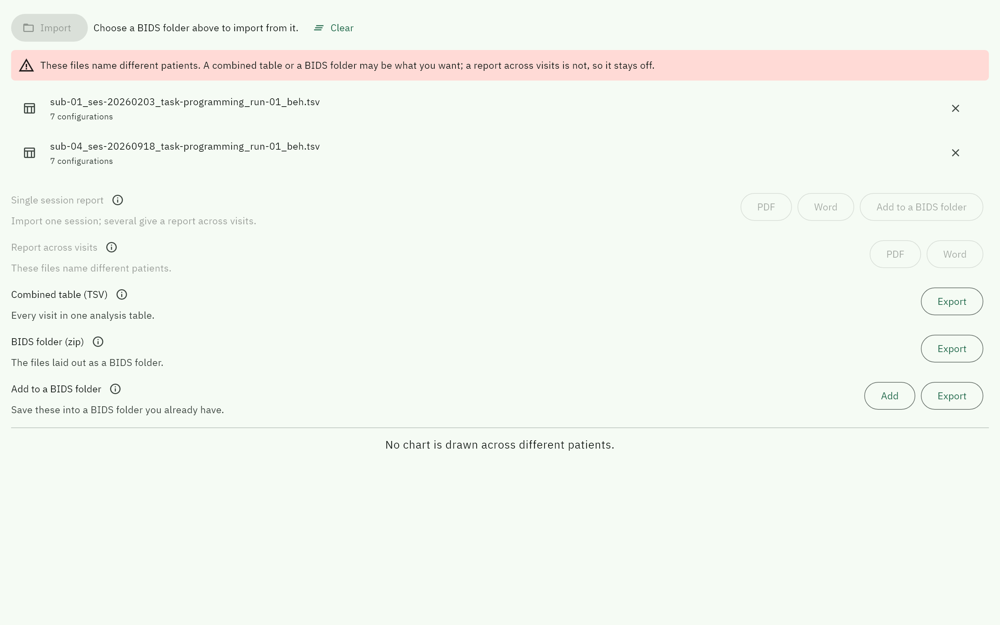
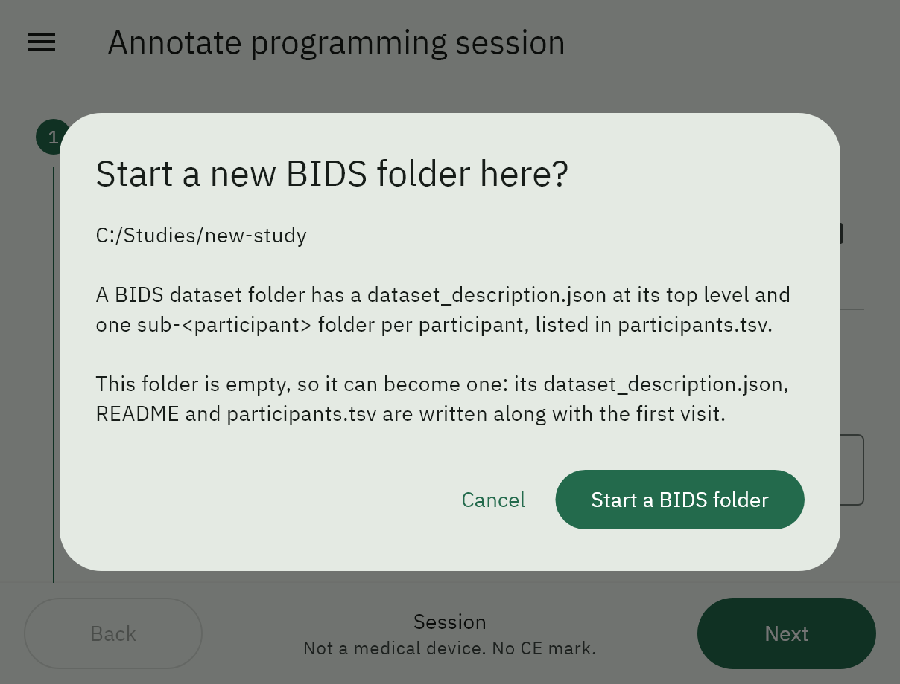
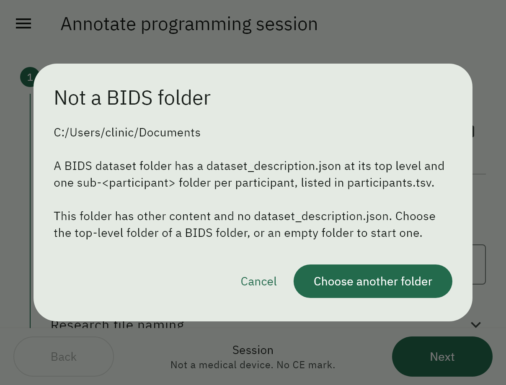
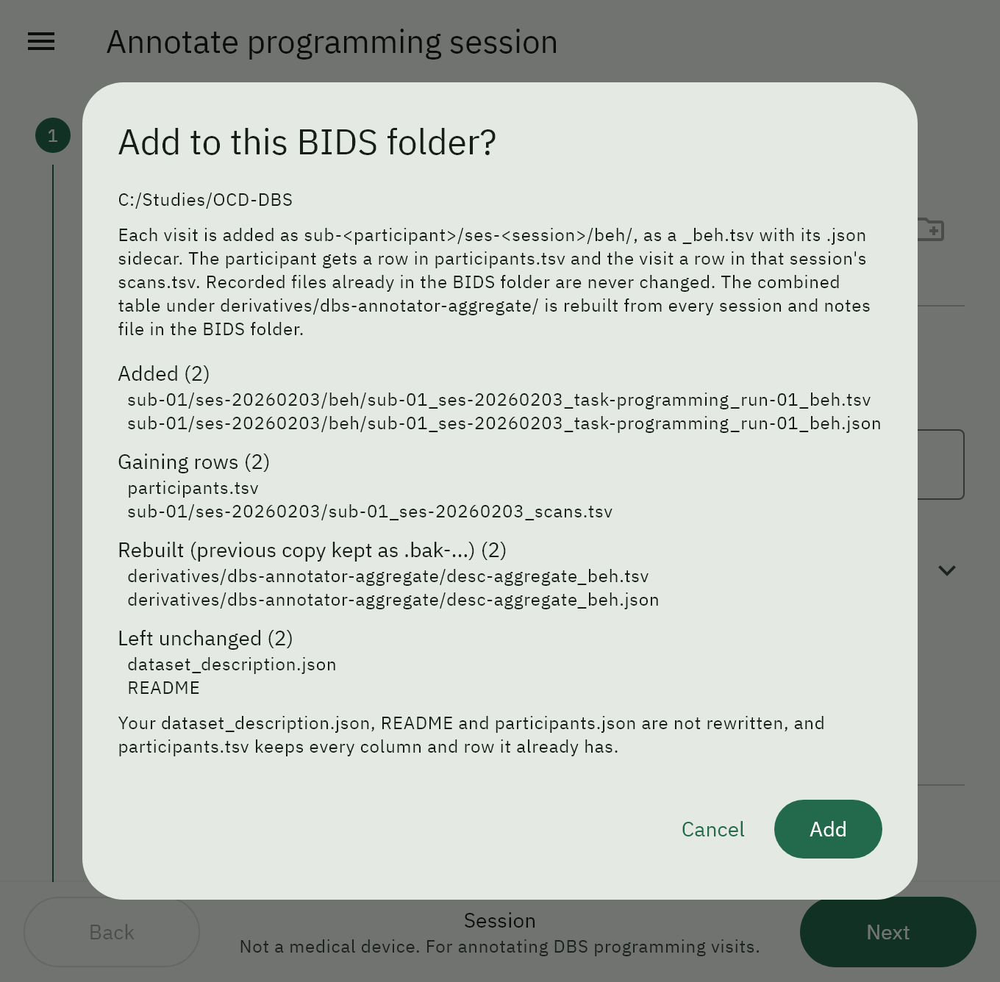
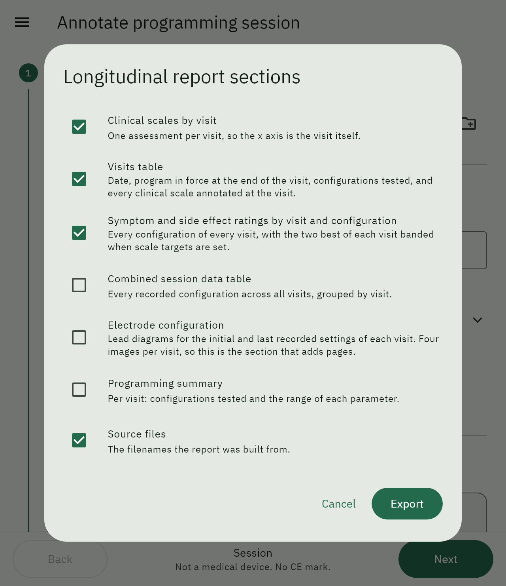

Import and export
=================

On the :ref:`Setup step <setup-step>`, import the session files you have, or a
whole BIDS folder, then take whatever they support. This never changes the
files you give it: it reads them, shows what is in them, and produces documents
and BIDS folders from them. Into a BIDS folder you choose it writes only what
you ask it to add, and only after you have confirmed the list of files.

The whole screen scrolls as one page, from the import buttons down through the
actions to the preview, so a long session table never squeezes the rest.

.. raw:: html

   <video controls muted playsinline preload="metadata" width="100%"
          poster="../_static/videos/reports.png">
     <source src="../_static/videos/reports.mp4" type="video/mp4">
   </video>

Two visits imported, the report across visits's sections
chosen, the scale targets it ranks by, then the export.

         every action listed and disabled
   :width: 100%

   Before anything is imported. Every action is listed, disabled, with the
   reason underneath rather than hidden until you tap it.

Importing
---------

**Import TSVs** takes several files at once. Each is classified by its
**columns**, not its name, so a file renamed by hand still opens as what it is,
and a file that is neither a programming session nor a notes file is rejected by
name rather than loaded as a screen of blank rows.

A file already in the list is refused by name. Two files with the same basename
would collide in a BIDS folder and would be double-counted in a combined table,
so the duplicate is dropped rather than silently merged.

.. _load-from-dataset:

Loading from a dataset
----------------------

When your visits are already filed in a BIDS folder, **Import from a BIDS folder** reads
them from there instead of one import at a time. On Windows, macOS and Linux you
choose the dataset folder; on iPadOS and Android you choose the dataset as a
``.zip``, because those systems do not let an app read a folder you pick.

Every session and notes TSV under ``sub-<participant>/ses-<session>/beh/`` is
found, including older ``_events.tsv`` files. Sidecars, imaging, other datatypes
and everything under ``derivatives/`` are left alone. A folder is read from the
chosen folder's own root, so choose the dataset folder itself, not a folder that
contains it; copies kept under ``old/``, ``sourcedata/`` and similar folders are
skipped. A ``.zip`` may wrap the dataset in one or more folders, and the
dataset is the folder holding its ``dataset_description.json``; a ``.zip``
without one is read for recordings in any folder. A checklist then shows each
participant with the number of files found, all ticked: untick the ones you do
not want, for example to keep a report across visits to one patient.

         the number of files for each
   :width: 42%
   :align: center

The chosen
files join the list exactly as if you had imported them, so every action below
works the same way, and a single file can still be removed.

What each import enables
------------------------

.. list-table::
   :header-rows: 1
   :widths: 34 66

   * - Action
     - Available when
   * - Single session report
     - Exactly **one** imported TSV: a session, or a notes file on its own
   * - Report across visits
     - Two or more TSVs **naming the same patient**. A notes file counts, so a
       session and its notes file give a report across visits
   * - Combined table (TSV)
     - Two or more TSVs, of any patients. Notes files count
   * - Create a BIDS folder (zip)
     - At least one file whose name carries a ``sub-`` entity
   * - Add to an existing dataset
     - As above

An action that is unavailable is greyed out **and says why**, in place of its
description.

Every action has an info button beside its name. It opens a short explanation
in three parts: how the export is made, which data it needs, and which files it
creates. The button works on a greyed-out action too, so you can see what that
action would need before importing anything.

         available, the report across visits and combined table are not
   :width: 100%

   One session. The report and a dataset are available; the report across visits
   and the combined table need more than one file.

Filing a single session into a dataset
--------------------------------------

The single session report row also offers **Add to dataset**, when the file
name carries BIDS entities (``sub-`` and ``ses-``). A dialog asks what to file:

* **Session TSV and sidecar**, ticked by default, goes to
  ``sub-<participant>/ses-<session>/beh/`` exactly as
  :ref:`Add to an existing dataset <dataset-merge-rules>` would place it.
* **Report**, unticked by default, as PDF or Word. It goes under
  ``derivatives/dbs-annotator-reports/``, at the same
  ``sub-<participant>/ses-<session>/beh/`` path as its session, named like the
  exported report. The derivative's ``dataset_description.json`` is written the
  first time a report is filed there.

You then choose the dataset folder (on iPadOS and Android, the dataset as a
``.zip``, which comes back merged), and the same confirmation as every other
add lists each file before anything is written. A report already filed at that
path is never overwritten: the confirmation lists its derivatives folder under
**Left unchanged**. Every derivative in the dataset is treated this way except
the combined table, which is rebuilt. If the session was moved to the next free
run because its name was taken, the report follows it to that run.

Several visits of one patient
-----------------------------

With two or more sessions naming the same patient, every action is available and
the preview shows the report across visits's session-scales figure: every block
of every visit, grouped under the visit's date, with the two best configurations
across all visits banded, exactly as the report will draw it.

Different patients
------------------

If the imported files name more than one patient, the screen says so and the
report across visits stays off. Combining two people into one report across visits
is a safety problem, not a formatting one. A combined table and a BIDS folder
across several patients are ordinary things to want, so those stay available. No
preview chart is drawn: one line across two patients would read as one
patient's trend.

         disabled with its reason
   :width: 100%

Notes alongside a session
-------------------------

A ``task-notes`` file imported together with a session makes two files, so it
gives a **report across visits**, with the data aggregated as for any set of
visits. Each note joins the session table of the visit on its own day (when two
sessions share a day, the one under way at the note's time), placed by its own
clock time with only the Time and Notes cells filled. A note from **any other
day**, a follow-up call a week later for example, is not slipped into a visit's
table: placed by clock time alone it would read as part of a visit it did not
happen in. Such a day gets its own numbered row in the Visits table, with only
its date filled, and its own table in the session data, under its date and in
the same columns as a visit's, with only Time and Notes filled. The session
tables are the **Combined session data table** section, which is off by
default and ticked for you when a notes file is imported.

Two or more notes files with no session also give a report across visits. It has
no visits, so it says that no session TSV was imported and lists every note by
date.

The notes must name the same patient as the sessions. If they do not, the
report across visits is greyed out with the reason.

It gets its own row rather than being written into a block's Notes cell,
because a note carries no configuration: attaching it to one would assert it was
recorded against stimulation settings the file never says it was. A note with no
readable timestamp is left out, since there is nowhere on a time axis to put it.

Adding to a dataset you already have
------------------------------------

**Add to an existing dataset** folds the imported files into a BIDS folder you
already have, rather than producing a separate one to reconcile by hand. It
offers both ways of doing that, so the choice is yours:

* **Add** writes into the folder you choose. Available on Windows, macOS and
  Linux; iPadOS and Android do not let an app write into a folder you pick, so
  the button is disabled there and says why.
* **Export** takes the dataset as a zip and gives a merged zip back, leaving the
  original untouched. Available everywhere, and the safe way to see what a merge
  produces before letting it near the real thing.

.. _bids-folder-requirements:

**What counts as a BIDS folder.** The folder (or the top level of the zip) must
hold a ``dataset_description.json``, with one ``sub-<participant>`` folder per
participant listed in ``participants.tsv``. If the folder you pick is empty, the
app offers to start a new dataset there, writing its
``dataset_description.json``, ``README`` and ``participants.tsv`` along with the
first visit. A folder with other content and no ``dataset_description.json`` is
refused, with this explanation, so BIDS files are never scattered through a
folder that is not a dataset.

   An empty folder: the app offers to start a dataset there.

   A folder with other content and no dataset_description.json.

**How a visit is added.** Each visit goes to
``sub-<participant>/ses-<session>/beh/`` as a ``_beh.tsv`` with its ``.json``
sidecar. Its participant gets a row in ``participants.tsv`` and the visit a row in
that session's ``sub-<participant>_ses-<session>_scans.tsv``. No recorded file
already in the dataset is changed. The combined table is the one derivative
that is rebuilt, as described in the last two rules below.

**Nothing is written until you have seen what will happen.** Every Add opens a
dialog that restates how the visit is added and lists every file that will be
added, every index file that will gain rows, any file moved to the next free
run, the combined table when it will be rebuilt (with a note that a folder merge
keeps the previous copy), any recorded file left out of that table, and
everything left unchanged. This is the only operation in the app that writes to
data it did not create, and it has no undo.

.. _dataset-merge-rules:

The rules it follows, and why each one exists:

.. list-table::
   :header-rows: 1
   :widths: 34 66

   * - Files
     - What happens
   * - ``dataset_description.json``, ``README``, ``participants.json``
     - Written only if missing. Yours carry the study's authors, licence and
       DOI; the app's would replace them with a generated stub.
   * - ``participants.tsv``, ``*_scans.tsv``
     - Unioned, never replaced. Every column you have is kept, so ``age``,
       ``sex`` or ``diagnosis`` survive, and a new subject is appended with
       those cells empty.
   * - ``sub-*/ses-*/beh/*``
     - Added only, never overwritten. A file whose name the dataset already
       uses for a different recording is filed under the next free run
       (``run-02``, ``run-03``) and listed as such, so any number of recordings
       per session can be added. A file identical to one already there is
       left as it is.
   * - ``derivatives/dbs-annotator-aggregate/``
     - The combined table and its sidecar are rebuilt from every session and
       notes TSV the dataset holds after the merge, the ones already there as
       well as the ones just added, and replace the previous table. Each row
       is named after the file as it sits in the dataset, including a run
       number the merge assigned. The table is derived data, so replacing it
       loses nothing; adding into a folder keeps the previous copy beside it
       with a ``.bak-`` suffix. A recorded TSV left out of the table is named
       in the confirmation and in the message shown afterwards, with the
       reason: it is a session or notes file that cannot be read, its name has
       no ``ses-`` entity, or another file with the same name is already in
       the table. A ``beh/`` TSV that is not this app's, such as another
       task recorded by another group, is not included and not mentioned; a
       file counts as this app's when it is a session or notes TSV, has the
       task ``programming`` or ``notes``, or has a sidecar written by this
       app. If no recording in the dataset can be included, the table already
       there is left as it is and listed under **Left unchanged**. Only
       recordings in the dataset's own ``sub-*`` folders count: a copy kept
       under another folder, such as ``old/`` or ``sourcedata/``, is not read.
       The folder's own ``dataset_description.json`` is written only if missing.
   * - ``.bidsignore``
     - When adding into a folder writes a ``.bak-`` copy of any file, the
       dataset's ``.bidsignore`` gets the line ``*.bak-*``, so the BIDS
       validator does not fail on the copies. The file is created if missing;
       otherwise the line is appended and the lines already there are left as
       they are. A ``.bidsignore`` inside a zip is carried over unchanged.
   * - Everything else
     - Untouched. Other datatypes, other derivatives and anything you keep
       alongside are never changed.

Merging the same files twice does nothing the second time.

A zip merge is refused above 200 MB, since a dataset carrying imaging does not
fit in an iPad's or Android device's memory. Adding into a folder on Windows,
macOS or Linux has no such limit.

Exporting
---------

Reports offer **PDF** or **Word**. Both report kinds show the
:ref:`report sections <dialog-report-sections>` dialog first, with
:ref:`scale targets <dialog-scale-targets>` reachable from inside it. For a
notes file every section applies, so the dialog is skipped.

The longitudinal chooser offers seven sections and opens with the same defaults
every time. Three of them start unticked, because they add pages:

* **Combined session data table** prints every configuration of every visit,
  one table per visit under its own heading.
* **Electrode configuration** draws four lead diagrams per visit, so six visits
  is roughly a page and a half of images.
* **Programming summary** gives the parameters used at each visit.

Scale targets do two things here. They mark the two best configurations
across **all** visits together, banded in the session-scales figure and shaded in
the per-visit tables, and they fix the y axis to the declared range instead of
fitting it to the data, so a scale sits on the same axis at every visit and a
drop between visits is a drop rather than a rescale. The ranking is meaningful
across visits because every visit's index is computed against the same targets
and declared ranges. The clinical figure carries no bands.

A TSV does not store scale targets, so the longitudinal export offers them
through **Scale targets…** in the chooser. If none are confirmed there, the
report ranks against the targets that dialog proposes, every scale minimised
over 0 to 10, and the preview on this screen uses the same. The report prints
the targets it ranked by under the session-scales figure and the session
tables; check them before filing it, and set any scale that should rise, such
as mood or energy, before exporting.
When a notes file is imported, **Combined session data table** starts ticked,
since that is where notes from a visit day are printed. The clinical figure's
axis takes each scale's range from your :ref:`clinical scales settings
<dialog-clinical-scales>`, because a TSV records scores but not ranges.

Every report export ends by asking, optionally, who recorded the session and,
for the session and report across visitss, who rated the scales, for the
attestation block. The names are not saved anywhere else.

A report is named from its source file's own BIDS entities with the data suffix
replaced by ``_report``, so the two sort together in a directory listing:

.. code-block:: text

   sub-01_ses-20260203_task-programming_run-01_beh.tsv
   sub-01_ses-20260203_task-programming_run-01_report.pdf

A file whose name carries no ``sub-`` entity keeps its own stem rather than
having one invented for it: a wrong subject label on a clinical document is
worse than an unhelpful filename.

The report across visits spans visits, so it carries no ``ses-`` and no
``task-``; ``desc-`` is the BIDS entity for naming what a computed file is. The
label carries the date the report was made, so a report made at a later visit
does not overwrite an earlier one:

.. code-block:: text

   sub-01_desc-longitudinal20261005_report.pdf

See :doc:`../reports` for what each document contains, and
:ref:`the combined table <combined-table>` for what the aggregated TSV holds.

The combined table
------------------

Every imported file goes into the combined table. A notes file adds one row
per note, with its time and text; the stimulation and scale columns of those
rows are ``n/a``.

The combined table always comes with its ``.json`` sidecar, which documents the
four key columns and every session column, so the table can be read without this
documentation at hand.

When every session in the list was :ref:`loaded from a dataset folder
<load-from-dataset>`, **Export** saves the table into that dataset first, where
BIDS puts a table that spans sessions:

.. code-block:: text

   derivatives/dbs-annotator-aggregate/
       dataset_description.json
       desc-aggregate_beh.tsv
       desc-aggregate_beh.json

The folder's ``dataset_description.json`` marks it as a derivative and names the
app that produced it; it is written once and never replaced. The table itself is
regenerated from the raw files, so exporting again replaces it, and the previous
version is kept beside it with a ``.bak-`` suffix, and the dataset's
``.bidsignore`` lists ``*.bak-*`` so the validator ignores the copy. Nothing in
the raw ``sub-*`` tree is written. The app then asks whether to save a copy
somewhere else too, as a ``.zip`` holding the table and its sidecar.

Adding visits to a dataset from Reports, into a folder or as a merged ``.zip``,
works differently: the table in the dataset is rebuilt from every session and
notes file the dataset holds afterwards, not only from the files just added.
A visit recorded straight into a dataset is added to the table when the
recording ends: on leaving the screen, closing the window, or choosing New or
Open. The app shows a short progress message while it does so, and names any
file it had to leave out. If the recording is interrupted instead, for example
because the app crashes, the table leaves out that visit until the next merge
from Reports or the next visit recorded into the dataset refreshes it. Saving
this combined table into the dataset, as described above, is different again:
it holds only the files you chose, and the next merge replaces it with the
table of the whole dataset. The ``.bak-`` copies that adding into a folder
leaves are hidden from the validator through ``.bidsignore``; see
:ref:`the merge rules <dataset-merge-rules>`.

If the list mixes files from the dataset with files imported from elsewhere, or
the dataset was loaded as a ``.zip``, nothing is written into the dataset and the
table and sidecar are exported as a ``.zip`` as usual.
