Annotate programming session
============================

Every time it starts, the app opens on a notice: it is not a medical device, it is for annotating
and documenting what happens during deep brain stimulation programming visits, and clinical
decisions remain with the clinical team. **I understand** continues to the app. A short form of
the same notice stays in the bar at the bottom of every step, and every report carries it in full.

After the notice the app opens on this screen. A programming session is annotated in five steps,
Session, Indication and devices, Initial assessment, Programming and Finish, shown across the top.
**Back** and **Next** sit in the bar at the bottom of the screen, with the name of the current step
between them. The menu button at the top left opens the :ref:`settings menu <settings-menu>`.

.. raw:: html

   <video controls muted playsinline preload="metadata" width="100%"
          poster="../_static/videos/record_block.png">
     <source src="../_static/videos/record_block.mp4" type="video/mp4">
   </video>

A visit from start to end: a new session, the stimulation parameters, the lead, the clinical
scales, then three configurations rated and saved, with the charts and table below.

.. _setup-step:

Step 1: Session
---------------

Session is where a visit starts, and where files from other visits come in and reports go out.

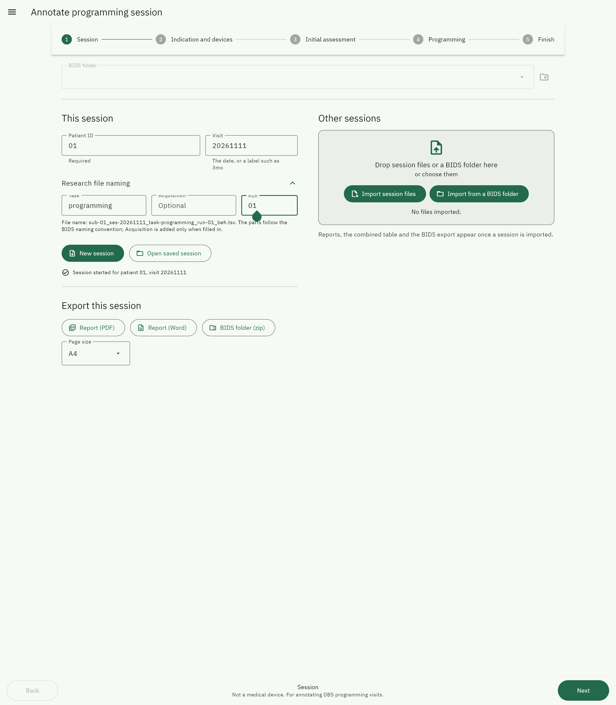
         patient ID, visit and research file naming, and Other sessions on the right with the
         drop zone and the import buttons
   :width: 100%

   The Session step with a session started for patient 01.

BIDS folder
~~~~~~~~~~~

Every visit is saved inside a BIDS folder, chosen in the bar across the top of the step. The
button beside the list adds another folder. You can keep several, for example one per cohort,
and manage them under **Storage folders (BIDS)** in the settings menu. The folder must be a BIDS
folder this app or another tool wrote, or an empty folder to start one in (see
:ref:`what counts as a BIDS folder <bids-folder-requirements>`). Once a session has started, the
folder is fixed for that visit.

This session
~~~~~~~~~~~~

**Patient ID** is required. When the BIDS folder already holds patients, a list offers them;
otherwise, or for a new patient, type the ID. For a known patient the app fills in the DBS
indication, the anatomical target, the leads and the IPGs from the patient's last visit, and says
so on the next step.

**Visit** is the visit date unless you type another label, such as ``preop`` or ``3mo``.

**Research file naming** opens the remaining parts of the file name: the **Task** (``programming``
unless you name another), an optional **Acquisition**, and the **Run** number. The file name they
make is shown under the fields, so you can see what will be written before anything is. Like every
BIDS label, they keep letters and digits only. See :doc:`the output format <../output_format>`.

Pressing **Next** with a patient ID entered starts the visit in the chosen folder and creates
``derivatives/sub-<id>/`` for the patient there. When the patient already has a run on that day,
the visit is saved as the next run (``run-02``, ``run-03``) and the **Run** field changes to
match; nothing is overwritten. The initial assessment of the new run opens filled in from the
earlier run, so you only change what differs, such as notes taken after a dose; each run keeps its
own. The visit is written into the folder at the first save and kept up to date at every save
after that: its ``beh/`` file, the run's row in the session's ``scans.tsv``, the visit's row in
the patient's ``sessions.tsv`` and the patient's row in ``participants.tsv`` (see
:ref:`where-values-live`). A line under the buttons says which patient, visit and run the session
was started for. Once a session is open, a **New session** button appears to start another one
without closing the app.

**Open saved session** continues a visit already saved, or opens a session file from an earlier
version of the app, which is saved in the current form from the next save. Opening a file also
adopts the lead models named in it, one per side, so the contact diagrams show the patient's
actual hardware. If the file names a model that is not in the catalogue, the app says so rather
than drawing the wrong lead. A file that is not a programming session, a notes file for instance,
is refused with an explanation rather than opened as empty rows.

Once the visit has a saved configuration, **Export this session** offers its report as PDF or
Word, its BIDS folder as a zip, and the page size, A4 or US Letter, as Finish does.

Other sessions
~~~~~~~~~~~~~~

Beside this session, **Other sessions** reads session files from earlier visits, or one whole BIDS
folder, and produces reports across visits, the combined table and BIDS folders. On Windows, macOS
and Linux you can drag session files or one BIDS folder onto the area; on every platform the
**Import session files** and **Import from a BIDS folder** buttons do the same. The actions appear
once a session is imported. See :doc:`import_export`.

The recovery copy
~~~~~~~~~~~~~~~~~

Every save is also written to a working copy inside the app, so a crash or a closed window loses
nothing. When you leave the session, or close the app window on Windows, macOS or Linux, the app
asks whether to keep that copy or discard it. Kept, it is offered back the next time you open the
app; discarded, it is gone and nothing is offered. It is never deleted without that answer: after
a crash, or when a tablet or phone app is swiped away, the copy is always kept.

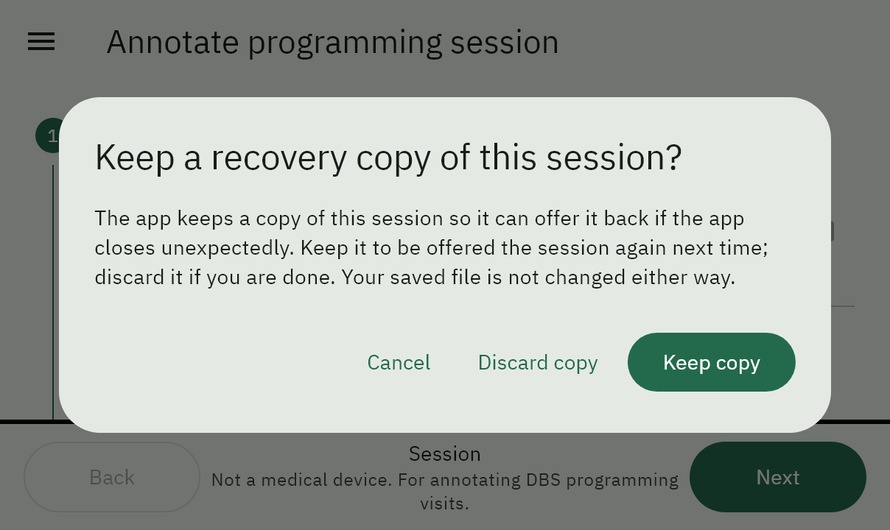

   Asked when you leave the session or close the window.

When a copy was kept, the next time you open the app it is offered back:

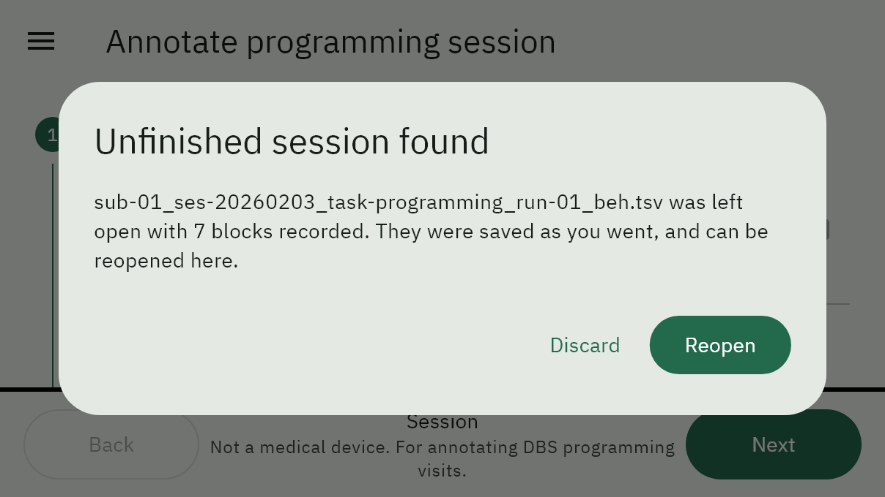

   Reopen continues the session; Discard deletes the copy. Closing the dialog any other way keeps
   it for next time.

Files with columns the app does not keep
~~~~~~~~~~~~~~~~~~~~~~~~~~~~~~~~~~~~~~~~

A session file can carry columns this app does not keep: one added by hand or by another tool, a
header name that appears twice, a value under a blank header, or a row with more cells than the
header. The app writes only the columns of the format, so saving over such a file would delete
that data. When **Open saved session** finds any, the message names them (for example *The app
does not keep these columns: lab_flag. Your file is left unchanged.*) and the app never writes to
that file. You can still annotate the visit: every configuration is saved in the app's own
recovery copy, so leaving the session asks whether to keep that copy. A line in Session and in
Finish repeats the names of the unkept columns for as long as the file is open. An export then
saves the session without them, under a name you choose, and on the desktop refuses the file you
opened as a target, as does **New session**. On Android and iOS the opened file is the app's own
copy of your file, so there is nothing to refuse. Opening another file, or starting or reopening
a session, ends this mode. Older files that spell a column the way earlier versions did, such as
``block_ID`` or a separate ``date``, ``time`` and ``timezone``, are read as before and do not
count as unkept.

Step 2: Indication and devices
------------------------------

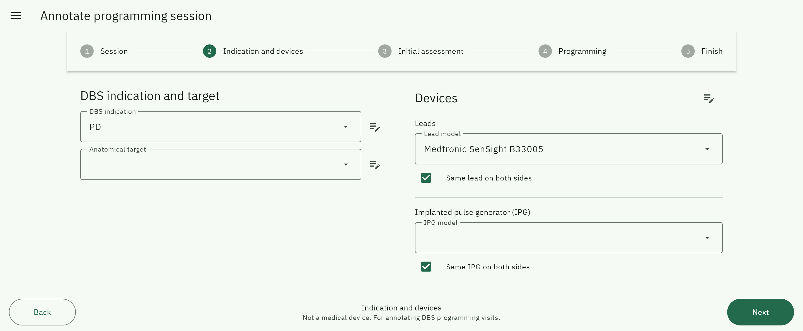
         and IPG models on the right, each with a box to use the same model on both sides
   :width: 100%

   Indication and devices for a Parkinson's disease patient with a directional lead.

The patient's **DBS indication** and **anatomical target**, and the implanted devices. The
indication chooses the clinical scales, the symptom and side effect ratings and the stimulation
defaults that the next steps start from. The button beside each list edits the choices it offers.

**Leads.** Choose the implanted lead model. The catalogue covers Medtronic, Boston Scientific,
Abbott, PINS and ALEVA leads, including segmented (directional) models. The diagrams are drawn to
each lead's real contact heights and spacings, so two different leads look different. **Same lead
on both sides** is ticked by default; untick it when the two leads differ, and a second list sets
the right lead. Each side's model is saved in its own column.

**Implanted pulse generator (IPG).** The same choice for the IPG, with **Same IPG on both sides**
for one generator driving both leads.

When the patient's last visit filled these values in, a line above them says so. Check each one:
a reimplantation changes the target, the leads or the IPG. Everything on this step stays editable
for the whole visit, and a change made after the first save is written into every saved row of
the visit, so the file never holds two answers for one visit. Changing the DBS indication of a
patient whose BIDS folder records another one asks first.

.. _dialog-devices:

Devices settings
~~~~~~~~~~~~~~~~

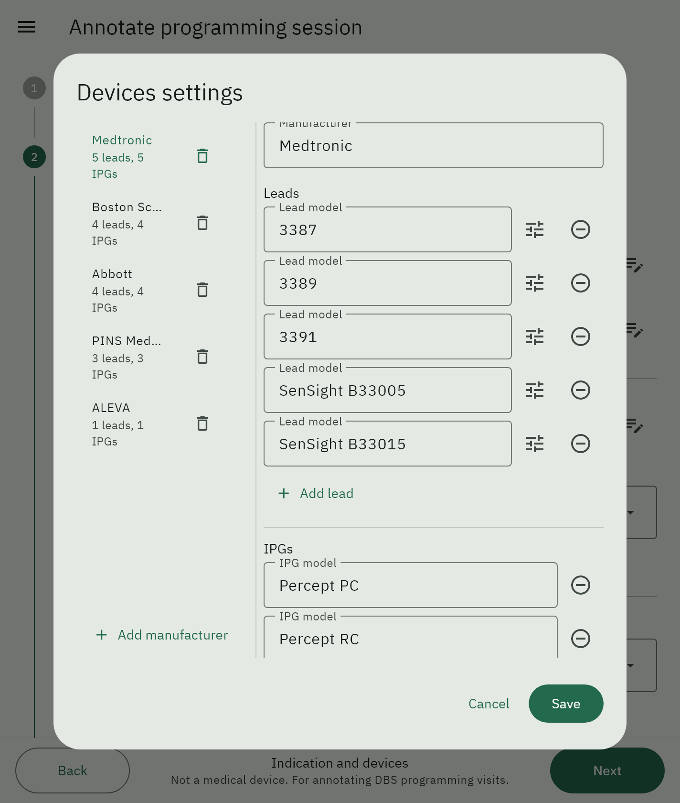

Opened by the button beside **Devices**, or by **Leads and IPGs** in the settings menu.

The lead and IPG models offered in this step, grouped by manufacturer. Add a manufacturer, a lead
model or an IPG model, or remove one. The list is kept in the app's own preferences.

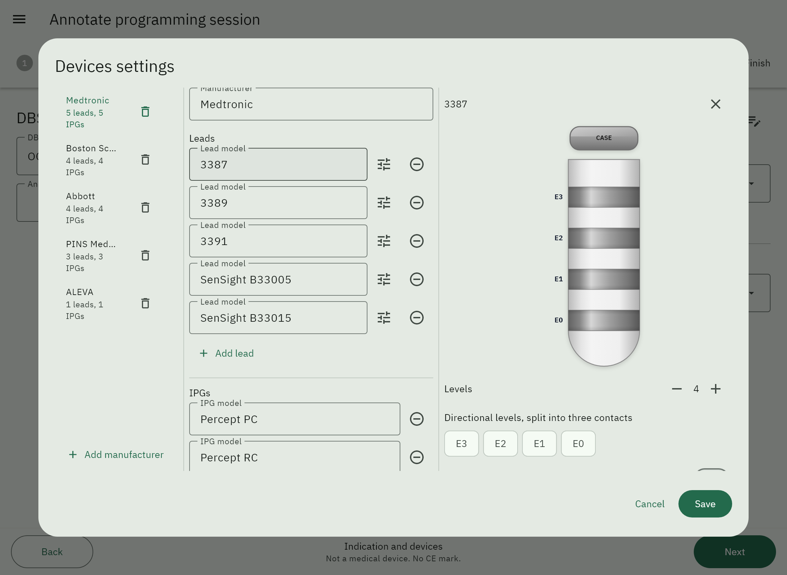

   The lead design of a Medtronic 3387.

The button beside each lead opens its design: the number of levels, which levels are directional
and split into three contacts, and whether there is a contact at the tip. The drawing beside it is
the one the contact diagrams will use, so a lead added here can be checked before it is used.

Step 3: Initial assessment
--------------------------

How the patient is on arrival, before anything is changed. The step is saved as the run's
initial assessment, in its row of the session's ``scans.tsv``, when you press **Next**.

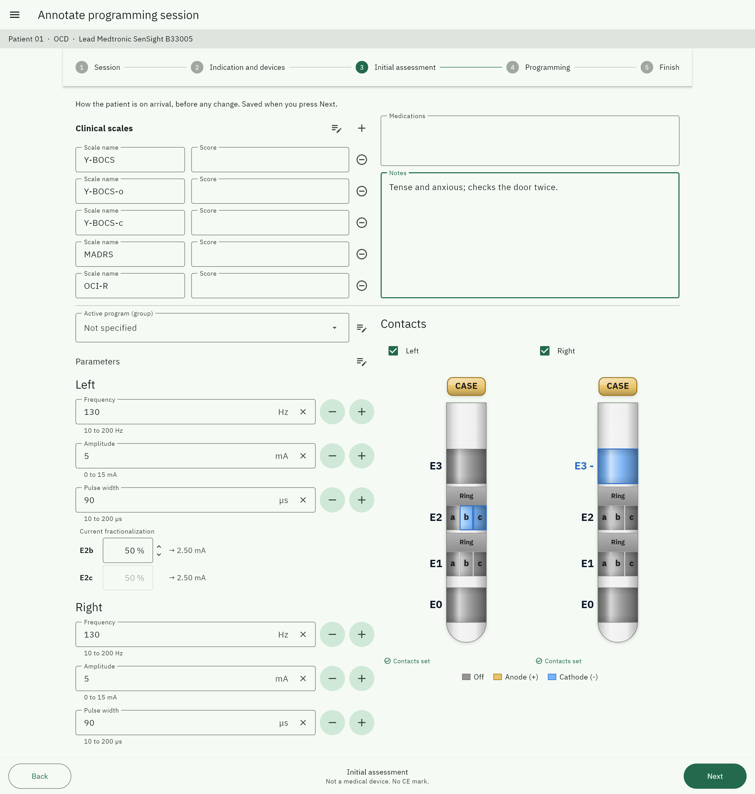
         program, the parameters per side and the current fractionalization on the left; the
         contacts diagram on the right
   :width: 100%

   The initial assessment of a Parkinson's disease patient: current steered across two segments
   of level 2 on the left lead.

**Clinical scales.** The baseline assessment: disease-specific scores such as Y-BOCS or MDS-UPDRS
Part III, typed once per visit. The indication fills the list; the plus button adds scales from
the presets and the button beside it edits the presets.

**Medications** and **Notes.** Free text about the patient's state on arrival. These notes belong
to the initial assessment.

**Active program (group).** The program the settings belong to, such as A, B or C. Manufacturers
call it the group.

**Parameters, per side.** Frequency, amplitude and pulse width, each with its unit and with the
permitted range under the field. The minus and plus buttons beside each field change the value: a
tap moves it by a fine step, a long press by a coarse one. A value can also be typed; one outside
the range is flagged at once and cannot be saved. When the indication has stimulation defaults,
they fill both sides as the step opens.

**Current fractionalization.** When more than one cathode is active, the share of the current on
each contact appears under the parameters, with the milliamps each share works out to. Those are
the ``E2b`` and ``E2c`` rows in the screenshot above.

**Contacts.** The diagram of each lead, described under :ref:`selecting-contacts`.

Several cards have a button that edits the choices they offer. These are picklists: they apply to
every future session and live in the app's own preferences, never in a session file, so editing
one changes nothing already saved. The dialogs below are the ones you meet in this step and the
next.

.. _dialog-programs:

Programs
~~~~~~~~

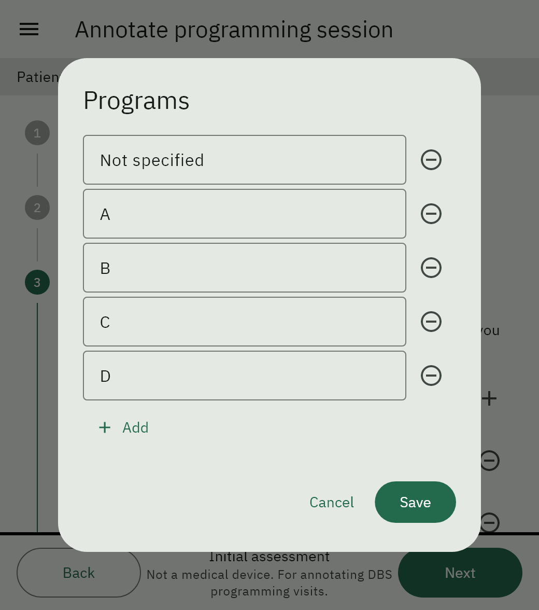

Opened by the button beside **Active program (group)** in Initial assessment and Programming, or
by **Programs** in the settings menu.

The program labels offered by the list: ``A``, ``B``, ``C`` and so on, or whatever your centre
uses.

.. _dialog-parameter-presets:

Stimulation defaults
~~~~~~~~~~~~~~~~~~~~

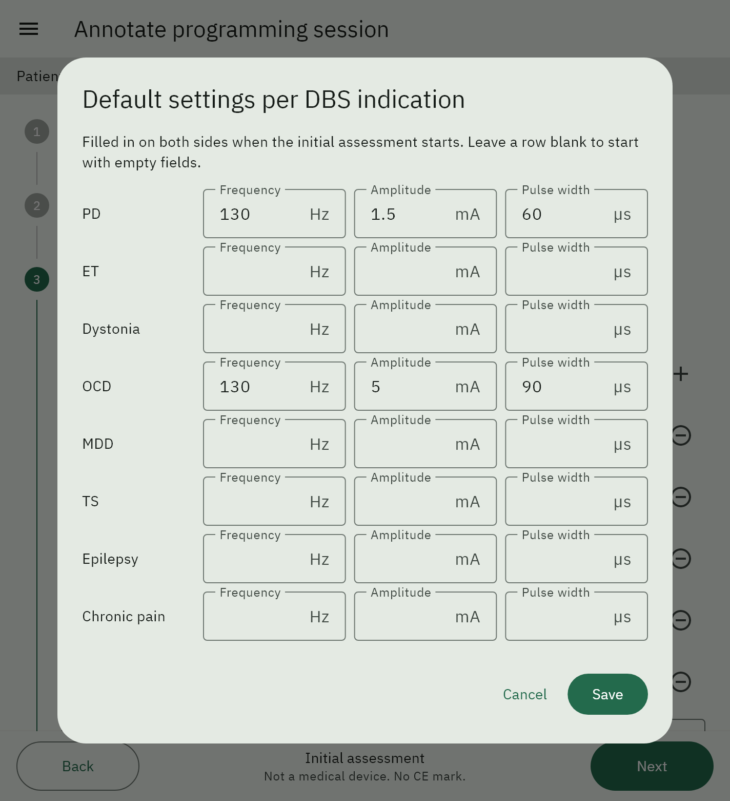
         frequency, an amplitude and a pulse width
   :width: 45%
   :align: center

Opened by the button beside **Parameters**, or by **Stimulation defaults** in the settings menu.

One row per DBS indication, with the frequency, amplitude and pulse width filled in on both sides
when the initial assessment starts. Leave a row blank to start with empty fields. These are a
starting point, not limits: each field accepts any value within the permitted range for that
parameter. A value that is not a number, or that falls outside the permitted range, is refused
with the reason shown in the dialog rather than being silently dropped.

.. _dialog-clinical-scales:

Clinical scales settings
~~~~~~~~~~~~~~~~~~~~~~~~

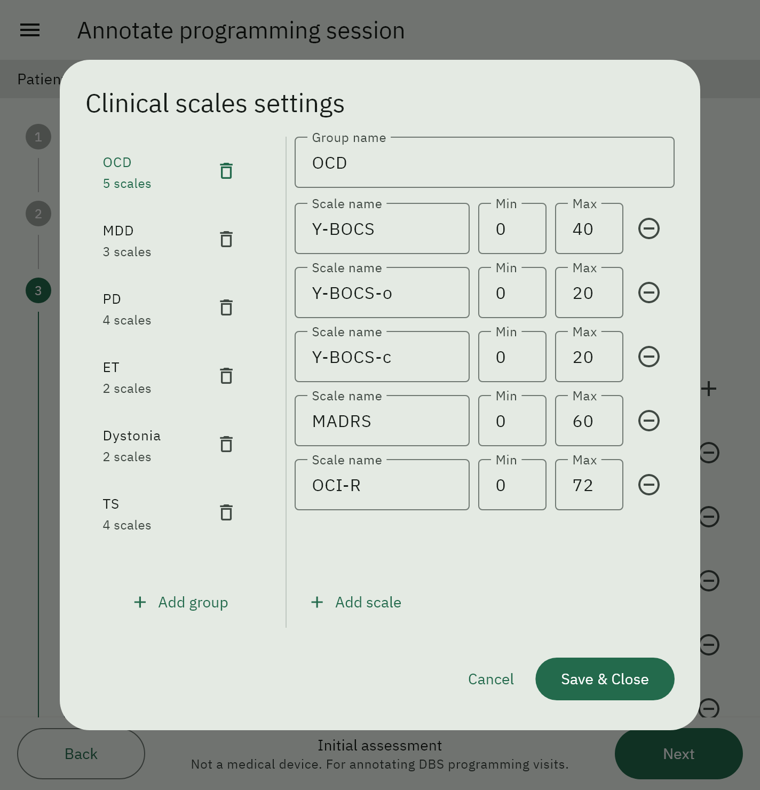
         scale names on the right
   :width: 50%
   :align: center

Opened by the button on the **Clinical scales** card, or by **Clinical scales** in the settings
menu.

Edits the clinical scales offered per indication: the group names (OCD, MDD, PD, ET, Dystonia,
TS), the scale names inside each, and each scale's **Min** and **Max**. The range is optional and
is used only to draw the longitudinal report's clinical figure on the scale's own axis; it is
never printed. The bundled scales come with their published total ranges where a name identifies
one instrument (Y-BOCS 0 to 40, MADRS 0 to 60, and so on). Names that stand for more than one,
such as HAM-D or MDS-UPDRS, are left blank for you to fill in.

.. _selecting-contacts:

Selecting contacts
~~~~~~~~~~~~~~~~~~

Tap a contact to cycle it from off, to anode, to cathode, and back to off. Tap the case to use it
as the anode. Segmented levels show their three segments plus a *Ring* strip that activates the
whole level at once. The box beside each side's name turns that side on or off. Under each lead,
**Contacts set** confirms a configuration that can stimulate.

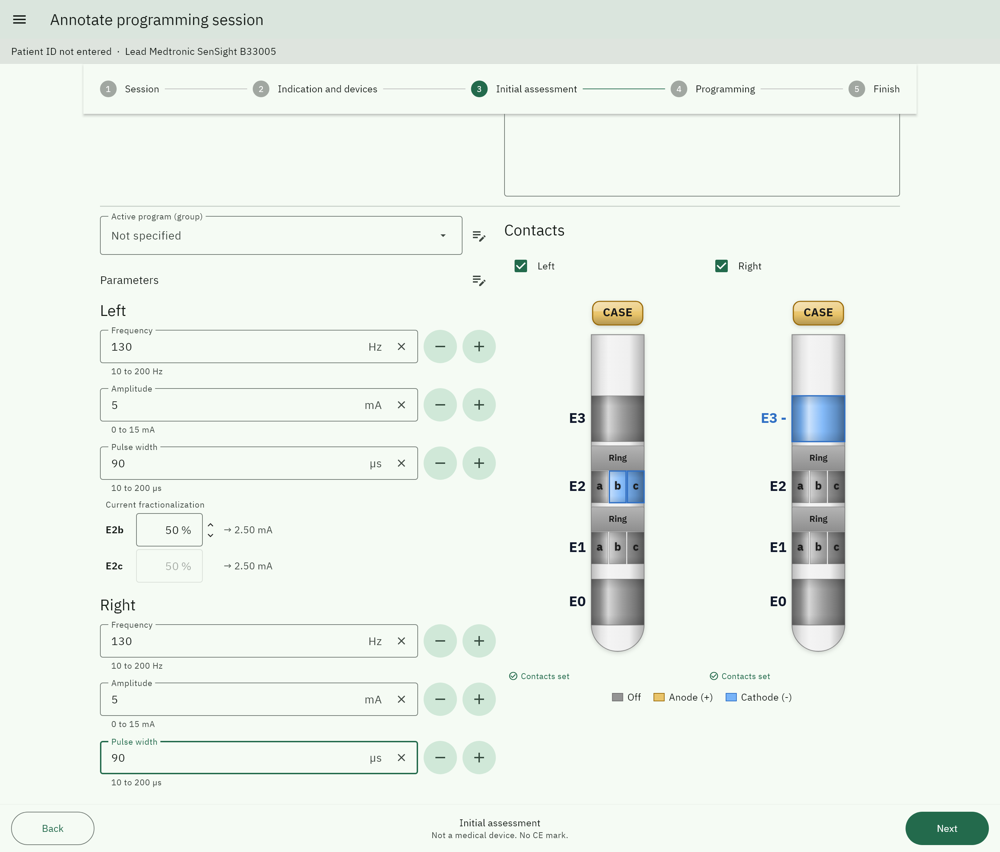
         off, anode and cathode
   :width: 100%

   A valid configuration: two segments of level 2 as cathodes on the left, a ring contact on the
   right, the case as the anode on both.

Invalid combinations are applied anyway and flagged as you build them, so you can work through a
configuration in whatever order suits you rather than having edits rejected midway:

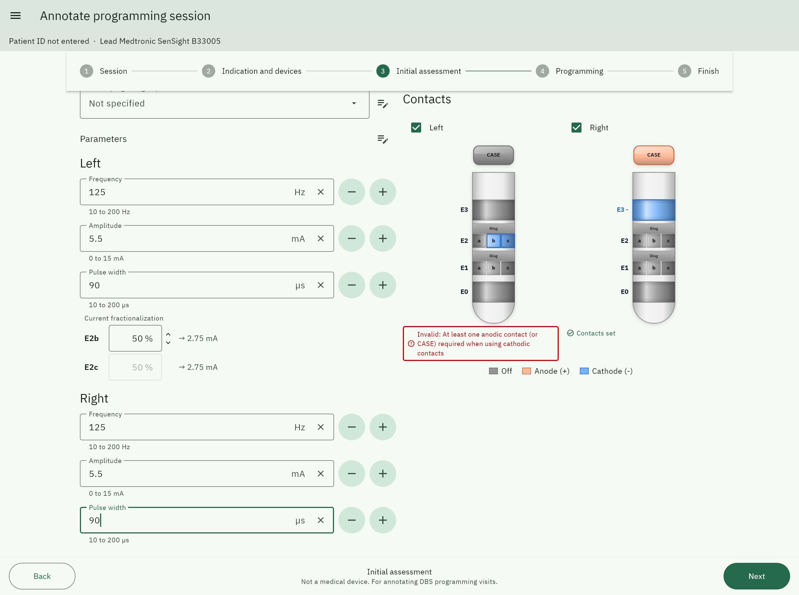

   The same cathodes with no anode selected. The change is kept; the message says why it will not
   stimulate.

Narrow screens
~~~~~~~~~~~~~~

Below about 900 logical pixels (a phone, or a tablet held in portrait) the two columns stack into
one. Everything is present; there is simply more scrolling.

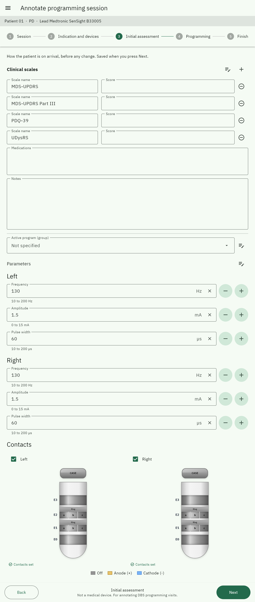

   Initial assessment in the single-column layout.

Step 4: Programming
-------------------

The loop, repeated once per configuration tested.

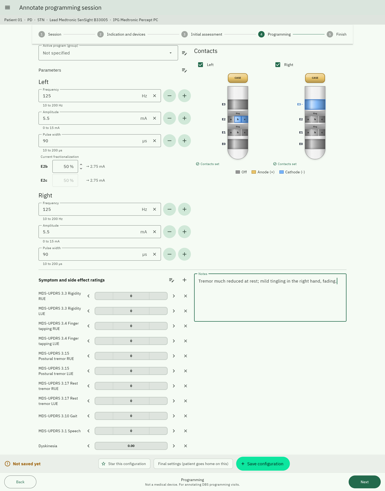
         ratings and notes below; the bar with Star this configuration, Final settings and Save
         configuration above Back and Next
   :width: 100%

   One configuration set and rated, ready to save.

The parameters and contacts work as in Initial assessment, and start from the settings entered
there. Change what the configuration tests, then rate the patient.

Symptom and side effect ratings
~~~~~~~~~~~~~~~~~~~~~~~~~~~~~~~

Quick ratings taken at every configuration, each on a fixed range, so configurations can be
compared within the visit. The indication fills the list: for Parkinson's disease, items of the
MDS-UPDRS Part III per side (``RUE`` and ``LUE`` for the right and left upper extremity), gait,
speech and dyskinesia. The plus button adds ratings from the presets, and the button beside it
edits the presets. Keeping the set the same for the whole session is what makes the ratings
comparable between configurations.

Each rating is a slider. A discrete rating moves in whole points, as the MDS-UPDRS items do; a
continuous rating takes any value on the bar. The arrows on either side move the slider one step.
A rating that was not assessed can be marked omitted with the cross at the end of its row, which
saves ``n/a`` rather than a made-up number.

Anything observed at that configuration, a side effect included, goes in **Notes**, which belong to
the configuration they were typed for.

.. _dialog-session-scales:

Symptom and side effect ratings settings
~~~~~~~~~~~~~~~~~~~~~~~~~~~~~~~~~~~~~~~~

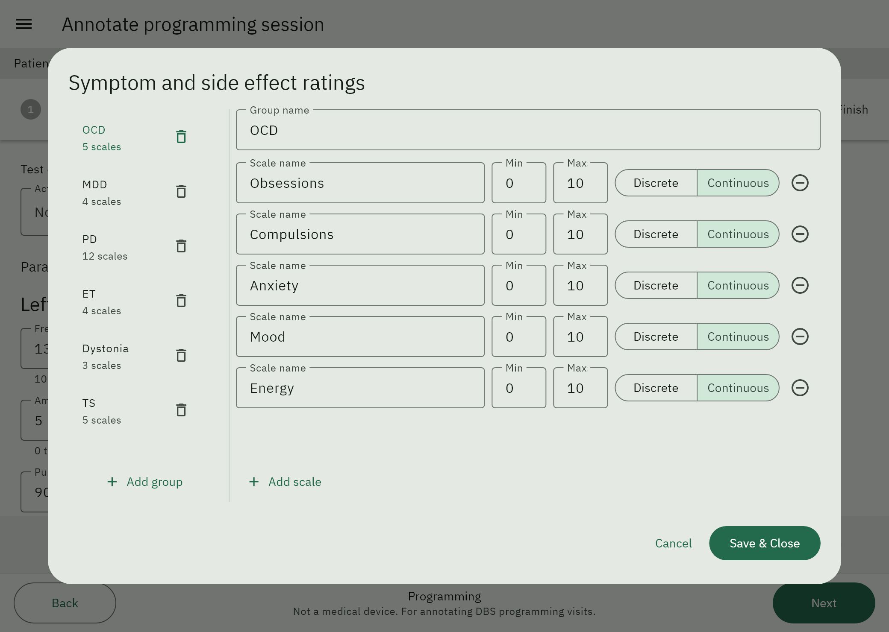
         group each scale's name, minimum, maximum and a Discrete or Continuous choice
   :width: 50%
   :align: center

Opened by the button on **Symptom and side effect ratings**, or from the settings menu.

The same shape as the clinical scales dialog, with two differences. Each row carries a minimum and
maximum, because the ratings are taken on a slider at every configuration and need a range. Each
row also chooses **Discrete**, whole points only, or **Continuous**, any value on the bar.

Saving a configuration
~~~~~~~~~~~~~~~~~~~~~~

The bar above **Back** and **Next** holds three controls, always in reach while you program.

**Star this configuration** marks the clinician's impression of a configuration worth noting. It
does not affect the ranking.

**Final settings (patient goes home on this)** marks the configuration being saved as the one the
patient leaves with (``is_final`` in the file). It is confirmed when the session ends: moving on to
Finish asks which configuration the patient leaves on, defaulting to the one marked, else the last,
with **Not recorded** as a choice. Reports head a configuration **Left on (marked by the
clinician)** only when it was confirmed this way, and **Last configuration tested** otherwise.

**Save configuration** saves it. The notes clear, ready for the next one; the parameters and
contacts stay, so a single amplitude change is one edit rather than a full re-entry.

The same step in the dark theme:

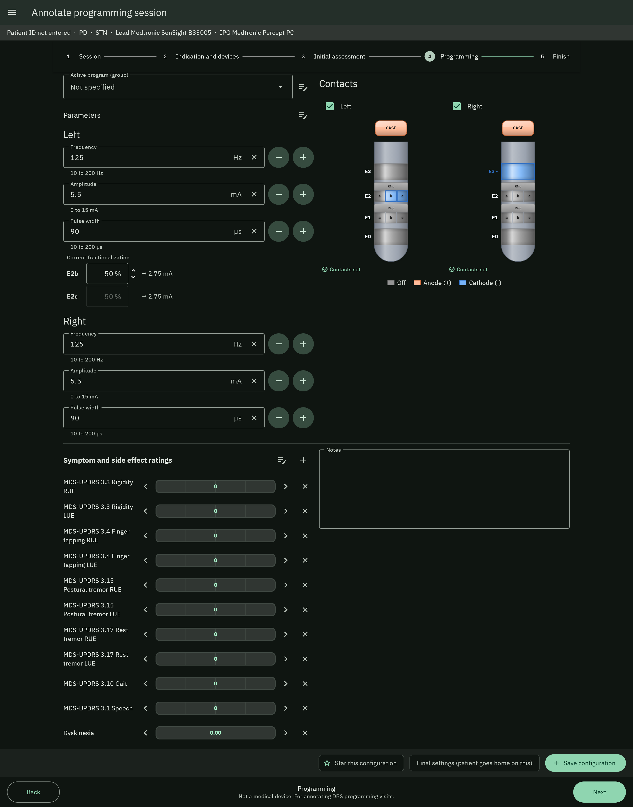

   Dark theme. The anode and cathode colours are deliberately identical in both themes, because
   they are the safety-relevant part of the drawing.

Reviewing as you go
~~~~~~~~~~~~~~~~~~~

Under the step, **Configurations tested** counts the configurations saved so far, and shows them
two ways.

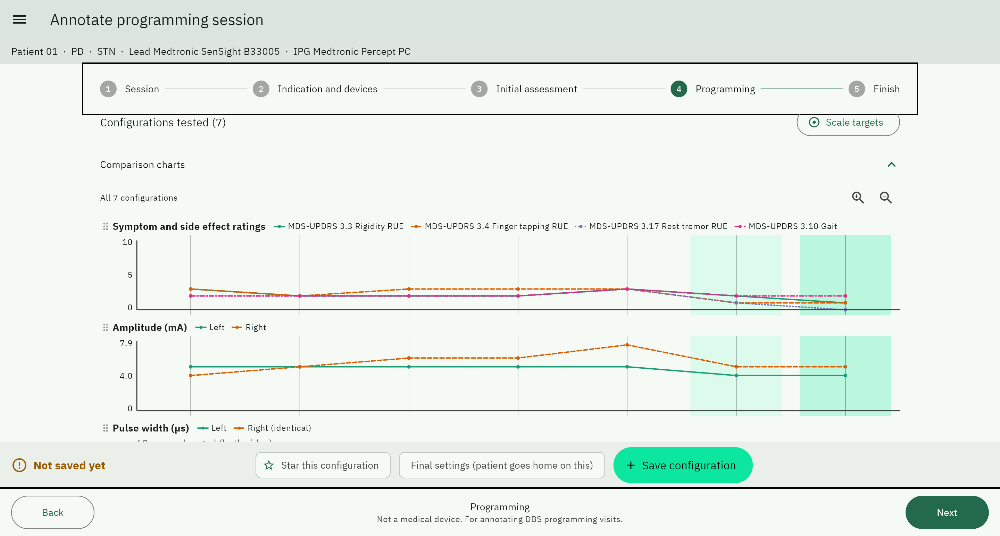
         pulse width and frequency, with a series key
   :width: 100%

   The comparison charts: ratings, amplitude, pulse width and frequency on one time axis.

**Comparison charts** stack the ratings, the amplitude, the pulse width and the frequency on one
time axis, so a dip in a rating can be read against the amplitude that preceded it. They scroll
horizontally, showing the most recent configurations by default, with zoom controls and drag
handles to reorder the panels.

**All configurations** is a table of every configuration saved, numbered in the ``#`` column and
typed ``Initial`` or ``Test``. Values that belong to the configuration (time, program, parameters)
are printed once rather than repeated on every rating row, and a heavy rule marks each boundary.
The star of a configuration can be set or cleared here too. Once scale targets are set, the rows
of the best and second-best configurations are shaded in the same greens as the charts, and the
shading moves as each configuration is saved.

**Scale targets** sets what "better" means per rating (lower, higher, or closest to a value).
Until they are set, nothing is ranked; see :ref:`scale-targets`.

.. _dialog-scale-targets:

Scale targets
~~~~~~~~~~~~~

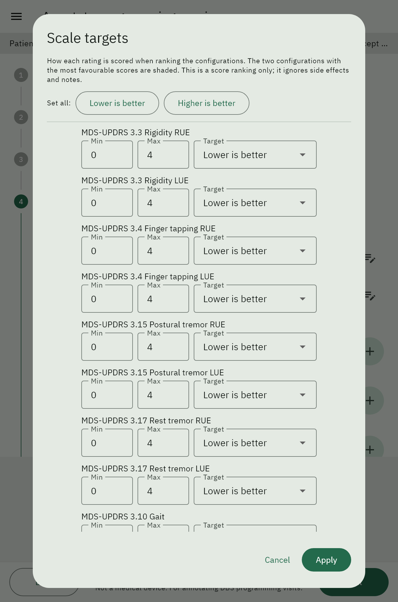

Opened by **Scale targets** in Programming, from the settings menu, or from the report sections
dialog.

Says how each rating is scored when ranking the configurations, which is the input the ranking
needs and the one thing only you can supply. The two configurations with the most favourable
scores are shaded. This is a score ranking only: it ignores side effects and notes. **Set all**
fills the column in one tap for a set of ratings that all run the same way.

Each rating gets a target: lower is better, higher is better, a custom target (closest to a stated
value, which reveals a *Value* field), or ignore. Until targets are set, no configuration is
ranked anywhere: see :ref:`scale-targets` for the definition of the aggregate index and
:ref:`what-the-reports-do-not-say` for its limits.

Step 5: Finish
--------------

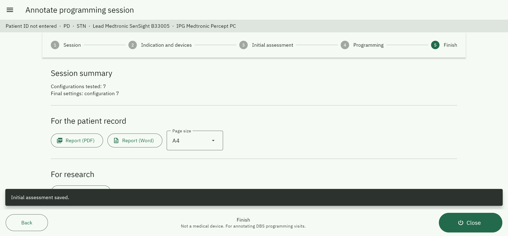
         BIDS folder for research, and the Close button
   :width: 100%

   Finish after seven configurations, with the final settings confirmed as configuration 7.

**Session summary** gives the number of configurations tested, the final settings, and where the
visit was saved.

**For the patient record** exports the session report as PDF or Word, on the page size chosen
beside the buttons. **For research** exports the visit as a :ref:`BIDS folder <bids-dataset-export>`
in a zip file. Choosing a report opens the report sections dialog first; see :doc:`../reports` for
what each section contains. Exporting a report also asks, optionally, for the names printed under
**Documented by** and **Rated by**: who annotated the session and who rated the scales. The names
are printed in the report's attestation section and saved nowhere else; a name left empty leaves the
line for a signature by hand.

On Finish, **Close** takes the place of **Next**. It asks the usual question about the recovery
copy, then closes the app.

.. _dialog-report-sections:

Report sections
~~~~~~~~~~~~~~~

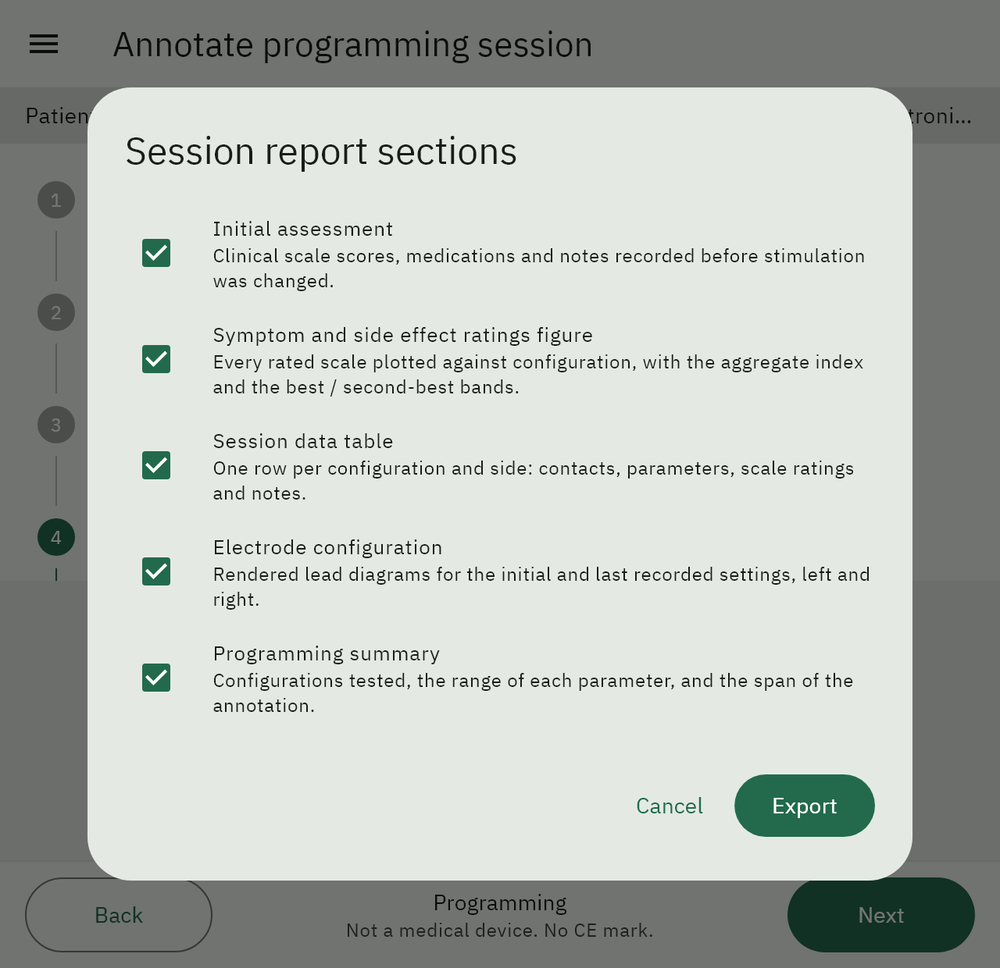

Appears when you export a report, before the save dialog. Each report kind has its own list, and
the dialog title says which one you are choosing for:

* **Session report sections**: initial assessment, symptom and side effect ratings figure,
  session data table, electrode configuration and programming summary.
* **Longitudinal report sections**: clinical scales by visit, visits table, symptom and side
  effect ratings by visit and configuration, combined session data table, electrode
  configuration, programming summary and source files. The session data table, the
  electrodes and the programming summary start unticked, because they are the sections that
  add pages; tick them to include them.

Each section has a one-line description of what it adds. **Export** is disabled while nothing is
checked, because a report of a title page alone is not a document anyone wants. **Scale targets**
opens the dialog above without losing the selection, since the ranking those targets drive is what
several of these sections show.

The session report remembers its selection for the next export. The longitudinal report opens with
its defaults every time, so a section that adds pages, ticked once, is not carried into every later
report.

.. _settings-menu:

Settings menu
-------------

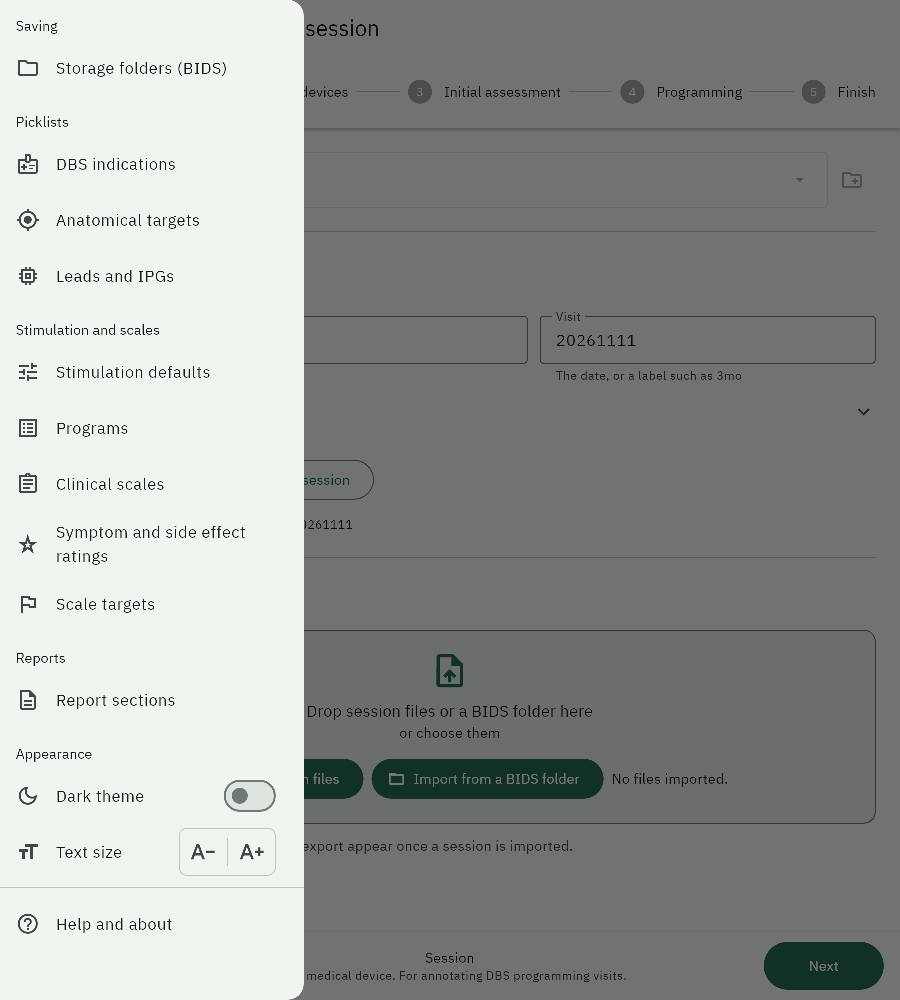
         sections, dark theme, text size, and help and about
   :width: 40%
   :align: center

The menu button at the top left opens the settings that apply to every session:

* **Storage folders (BIDS)**: the BIDS folders offered in Session, each with a name such as the
  cohort.
* **Picklists**: the DBS indications and anatomical targets, the leads and IPGs, the stimulation
  defaults, the programs, the clinical scales, and the symptom and side effect ratings, each
  opening the dialog described above.
* **Scale targets** and **Report sections**.
* **Dark theme** and **Text size**, kept for the next time the app opens.
* **Help and about**: the full notice, the version, and links to this documentation and the
  repository.
